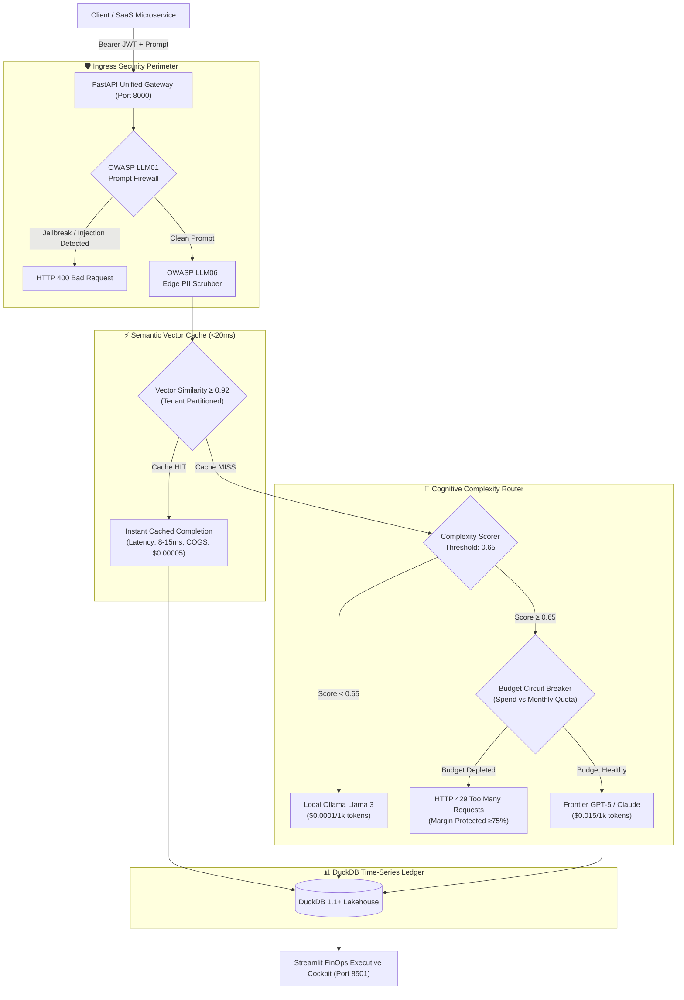

# ⚡ FinOps & Hybrid AI Resource Governance Gateway

[](https://www.python.org/)
[](https://fastapi.tiangolo.com/)
[](https://duckdb.org/)
[](https://streamlit.io/)
[](https://owasp.org/www-project-top-10-for-large-language-model-applications/)
[](LICENSE)
[](https://samuelhtampubolon.github.io/finops-ai-governance-gateway/)

An enterprise-grade, locally runnable **FinOps and Hybrid AI Resource Governance Gateway** engineered to eliminate runaway cloud inference costs, preserve SaaS gross margins (>75%), and enforce OWASP LLM security controls at microsecond latency.

---

## 🌐 Live Interactive GitHub Pages Demo
Explore the interactive FinOps calculator, real-time semantic cache simulator, complexity routing debugger, and OWASP LLM firewall directly in your browser:
👉 **[https://samuelhtampubolon.github.io/finops-ai-governance-gateway/](https://samuelhtampubolon.github.io/finops-ai-governance-gateway/)**

---

## 🎯 Business Problems & Executive Value Proposition

| Business Problem | Operational Reality | Gateway Architectural Solution |
| :--- | :--- | :--- |
| **Runaway Token Spend (PROB-01)** | SaaS platforms blindly dispatch routine queries to expensive frontier models ($15-$30/1M tokens), causing severe gross margin erosion when customers exceed tier limits. | **Cognitive Complexity Router:** Scores cognitive load (0.0–1.0) and deflects routine classification/extraction queries to local Ollama models ($0.10/1M tokens), reducing inference costs by **150x**. |
| **Redundant Inference (PROB-02)** | Enterprise users repeatedly ask semantically identical questions, waiting 1,500ms+ and paying full token cost on each redundant call. | **Zero-Dependency Semantic Cache:** Evaluates normalized dense vector embeddings in DuckDB to return verified completions in **<20ms at $0.00 token cost**. |
| **Missing COGS Attribution (PROB-03)** | Engineering teams receive aggregate cloud API bills but cannot attribute exact compute and token Cost of Goods Sold (COGS) to specific tenants, features, or tiers. | **Multi-Tenant DuckDB Ledger:** Captures exact token consumption per request with millisecond timestamps, computing real-time gross margin % and triggering automatic budget circuit breakers. |

---

## 📐 Unit Economics & Governing Equations

The gateway governs all inference traffic through explicit unit economics formulations:

### 1. Request-Level Cost of Goods Sold (COGS)
$$\text{COGS}_{\text{req}} = \left( \frac{\text{Prompt Tokens}}{1000} \times \text{Rate}_{\text{input}} \right) + \left( \frac{\text{Completion Tokens}}{1000} \times \text{Rate}_{\text{output}} \right) + \text{Overhead}_{\text{compute}}$$
- *Semantic Cache Hit:* $\text{COGS} = \$0.00005$ (Compute overhead only; $0 token cost).
- *Local Ollama Tier:* $\$0.00010$ input / $\$0.00020$ output per 1k tokens.
- *Frontier API Tier:* $\$0.01500$ input / $\$0.03000$ output per 1k tokens.

### 2. Tenant Gross Margin Percentage
$$\text{Gross Margin} \% = \left( \frac{\text{Monthly MRR} - \sum \text{COGS}_{\text{req}}}{\text{Monthly MRR}} \right) \times 100$$
*Target Threshold:* $\ge 75.0\%$.

### 3. Net Deflection Savings
$$\text{Savings}_{\text{req}} = \max\left(0, \text{COGS}_{\text{frontier\_hypothetical}} - \text{COGS}_{\text{actual}}\right)$$

---

## 🏗️ System Architecture & Data Flow



---

## 🛡️ OWASP LLM & API Security Hardening

1. **LLM01: Prompt Injection & Jailbreak Firewall**
   - Inspects prompts for instruction overrides (`ignore previous instructions`, `system prompt override`), persona hijacking (`DAN`, `jailbroken`), delimiter hijacking (`<|im_start|>system`), and obfuscated base64 payloads.
   - Deterministically blocks violations with HTTP 400 before routing to models.

2. **LLM06: Sensitive Information Disclosure (PII Scrubber)**
   - Automatically sanitizes prompts at the gateway perimeter using regex and Luhn checksum validation.
   - Redacts: Email addresses, Luhn-verified Credit Card Numbers, US SSN, Indonesian NIK (16-digit), phone numbers, and API/Bearer tokens.

3. **API1: Strict Tenant Cache Partitioning**
   - Vector search indexes are strictly scoped by `tenant_id`. Tenant A can never retrieve cached responses generated for Tenant B.

4. **API4: Denial of Wallet Circuit Breaker**
   - Tracks monthly USD spend atomically in DuckDB. Automatically downgrades or rejects requests with HTTP 429 when budget limits are breached.

---

## 🚀 Quickstart & Zero-Friction Local Execution

### Prerequisites
- Python 3.11 or 3.12
- Git

### 1. Clone & Setup Environment
```bash
git clone https://github.com/samuelhtampubolon/finops-ai-governance-gateway.git
cd finops-ai-governance-gateway

# Create and activate virtual environment
python -m venv .venv
source .venv/bin/activate  # On Windows: .venv\Scripts\activate

# Install dependencies
pip install -r requirements.txt
```

### 2. Launch Local Servers (Zero External Redis/API Dependencies)
```bash
python run_local.py
```
This single command automatically:
1. Bootstraps the local DuckDB database (`data/finops_ledger.duckdb`).
2. Pre-seeds 3,000 realistic multi-tenant telemetry logs and semantic cache entries across 5 customer tiers.
3. Starts the **FastAPI FinOps Gateway** at `http://localhost:8000`.
4. Starts the **Streamlit FinOps Cockpit** at `http://localhost:8501`.

---

## 🧪 Automated Test Verification

Run the test suite to verify all unit economics, cache isolation, and security controls:
```bash
pytest -v
```

### Test Results Breakdown
```text
tests/test_budget_and_prompt_firewall.py::test_owasp_prompt_injection_detection PASSED
tests/test_budget_and_prompt_firewall.py::test_owasp_pii_scrubbing PASSED
tests/test_budget_and_prompt_firewall.py::test_budget_circuit_breaker_enforcement PASSED
tests/test_budget_and_prompt_firewall.py::test_gateway_api_injection_blocking PASSED
tests/test_budget_and_prompt_firewall.py::test_gateway_api_budget_exhaustion_429 PASSED
tests/test_budget_and_prompt_firewall.py::test_gateway_api_health_and_readiness PASSED
tests/test_cache_and_router.py::test_vector_embedding_and_cosine_similarity PASSED
tests/test_cache_and_router.py::test_sub_20ms_semantic_cache_lookup PASSED
tests/test_cache_and_router.py::test_cross_tenant_cache_isolation PASSED
tests/test_cache_and_router.py::test_complexity_router_routine_vs_frontier PASSED

============================= 10 passed in 1.76s ==============================
```

---

## 📡 API Reference & Endpoints

### 1. Health Probes
- `GET /healthz` - Kubernetes liveness check.
- `GET /readyz` - Readiness probe verifying DuckDB and cache subsystem state.

### 2. Issue Tenant Bearer JWT
`POST /api/v1/auth/token`
```json
{
  "tenant_id": "tenant-acme-corp",
  "plan_tier": "enterprise"
}
```

### 3. Governed Chat Completion
`POST /api/v1/gateway/chat/completions`  
*Header:* `Authorization: Bearer <TOKEN>`
```json
{
  "messages": [
    {"role": "user", "content": "How do I configure Single Sign-On (SSO) with Okta?"}
  ],
  "feature_tag": "customer_support",
  "force_refresh": false
}
```

*Response (Sub-20ms Cache Hit):*
```json
{
  "id": "req-8f20ab1e712c",
  "created": 1729864200,
  "model": "semantic-cache-hit",
  "choices": [
    {
      "index": 0,
      "message": {
        "role": "assistant",
        "content": "To configure Okta SSO: Navigate to Admin Portal > Security > SSO..."
      },
      "finish_reason": "stop"
    }
  ],
  "usage": {
    "prompt_tokens": 28,
    "completion_tokens": 74,
    "total_tokens": 102
  },
  "finops": {
    "cache_hit": true,
    "latency_ms": 11.42,
    "cogs_usd": 0.00005,
    "savings_usd": 0.00264,
    "routed_model": "semantic-cache-hit",
    "complexity_score": 0.10,
    "pii_redacted": false,
    "redacted_categories": [],
    "tenant_id": "tenant-acme-corp",
    "remaining_budget_usd": 650.00
  }
}
```

### 4. Tenant Unit Economics
`GET /api/v1/finops/unit-economics`  
Returns tenant-scoped MRR, real-time COGS, gross margin %, and cache deflection savings.

---

## 🐳 Docker Deployment

Deploy with Docker Compose:
```bash
docker compose up -d
```
Access the gateway at `http://localhost:8000` and Streamlit at `http://localhost:8501`.

---

## 📄 Architecture Decision Records (ADR)
Detailed trade-off evaluations and design justifications are recorded in [ADR.md](ADR.md):
- **ADR-001:** In-Process Deterministic Vector Semantic Cache
- **ADR-002:** Deterministic Cognitive Complexity Routing
- **ADR-003:** Strict Multi-Tenant Cache Isolation & DuckDB Ledger
- **ADR-004:** Ingress Edge Prompt Firewall & PII Redaction
- **ADR-005:** Pre-Inference Budget Circuit Breakers

---

## ⚖️ License
MIT License. Developed for enterprise IT economics and AI FinOps governance.
